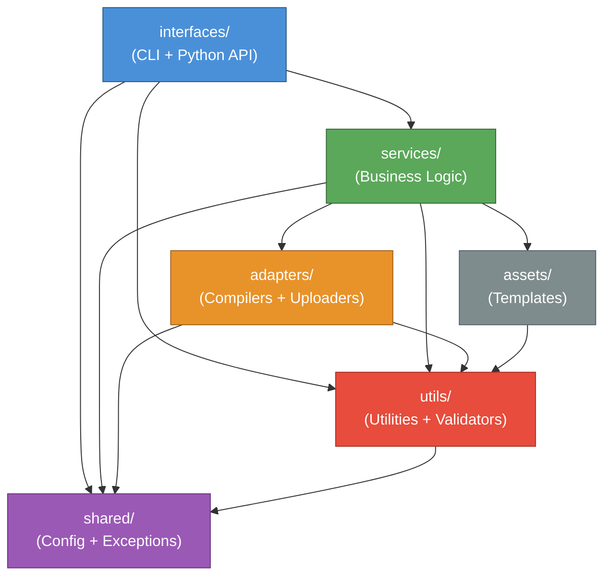

# Architecture — Layer Dependency Graph

Import dependency graph generated by [grimp](https://github.com/seddonym/grimp)
from the live `ezcompiler` source tree.

!!! info "Auto-generated"
    This page is regenerated at each documentation build from the actual source code.
    It reflects the **real** import graph, not a manually maintained diagram.

    To regenerate locally:

    ```bash
    PYTHONPATH=src python .scripts/dev/generate_architecture_graph.py
    ```

---

## Dependency Graph



---

## Layer Import Matrix

| Layer | Imports from |
|-------|--------------|
| `interfaces` | `services`, `shared`, `utils` |
| `services` | `adapters`, `assets`, `shared`, `utils` |
| `adapters` | `shared`, `utils` |
| `shared` | — |
| `utils` | `shared` |
| `assets` | `utils` |

---

## Layer Responsibilities

| Layer | Responsibility |
|-------|----------------|
| `interfaces` | Public entry points — CLI (`cli_interface`) and Python API (`EzCompiler`) |
| `services` | Business logic and pipeline orchestration (`CompilerService`, `PipelineService`, …) |
| `adapters` | Concrete compiler and uploader implementations (`CxFreezeCompiler`, `DiskUploader`, …) |
| `shared` | Cross-layer data structures and exceptions (`CompilerConfig`, `CompilationResult`, …) |
| `utils` | Pure utility functions and validators (`ZipUtils`, `FileUtils`, validators, …) |
| `assets` | Static templates consumed by `TemplateService` (config, setup, version files) |
